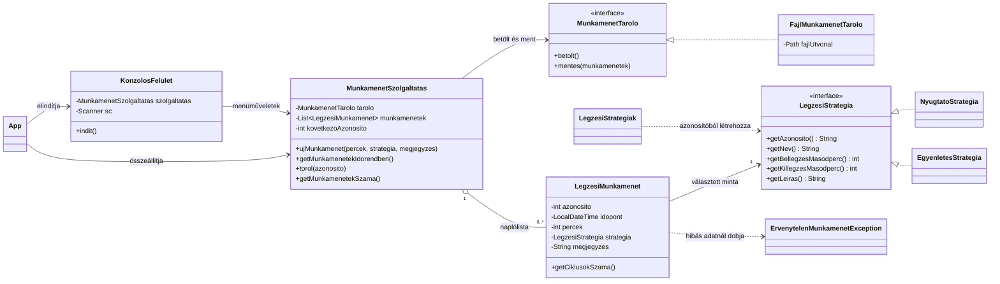

# UML és tervezési döntések

## Osztálydiagram

## A Strategy minta szerepe
A két légzési mód eltérő belégzési és kilégzési idővel dolgozik. A `LegzesiStrategia` interfész rögzíti a közös műveleteket, amelyeket a `NyugtatoStrategia` és az `EgyenletesStrategia` valósít meg. A `LegzesiMunkamenet` az interfészen keresztül kéri le a másodperceket a ciklusszámításhoz, így a viselkedés futásidőben a választott stratégiától függ. Új minta hozzáadásához elég egy új implementációt írni, a meglévő kód módosítása nélkül.

## Fő tervezési döntések
- A konzolos felület (`KonzolosFelulet`) külön rétegben marad, nem nyúl közvetlenül fájlokhoz, mindent a szolgáltatáson (`MunkamenetSzolgaltatas`) keresztül intéz.
- A mentés UTF-8 kódolású, tabulátorral elválasztott (TSV) fájlba történik (`azonosító`, `időpont`, `perc`, `mintaazonosító`, `megjegyzés`).
- A naplófájlt nem kell előre létrehozni; az első mentés automatikusan létrehozza az `adatok` mappát és a fájlt.
- Ha a fájlba mentés közben `IOException` történik, a szolgáltatás visszaállítja a memóriában lévő listát, hogy ne maradjon inkonzisztens állapot.

## Korlátok
- Egyetlen lokális fájlt kezel, nincs többfelhasználós vagy hálózati támogatás.
- Sérült fájlsor esetén a betöltés hibával leáll és kiírja a hibás sor számát.
- A ciklusszám matematikai becslés a megadott időtartam és minta alapján.